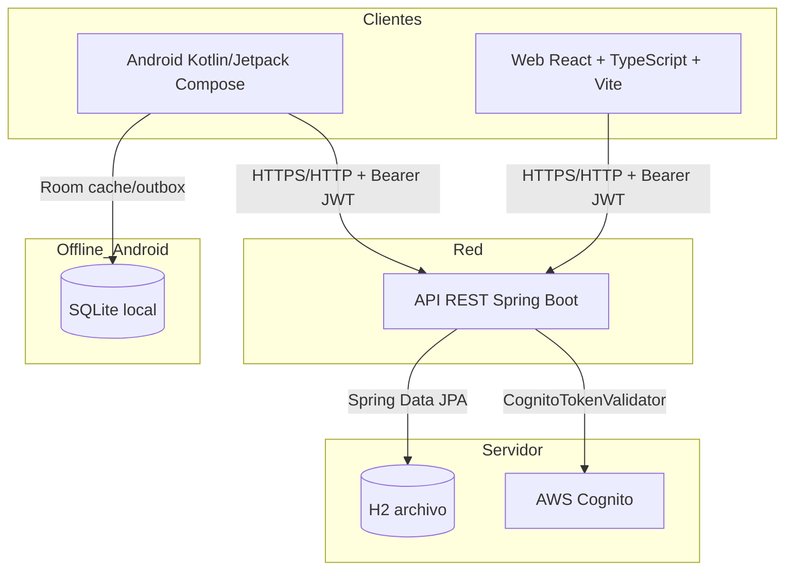
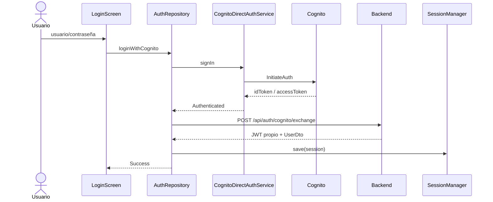
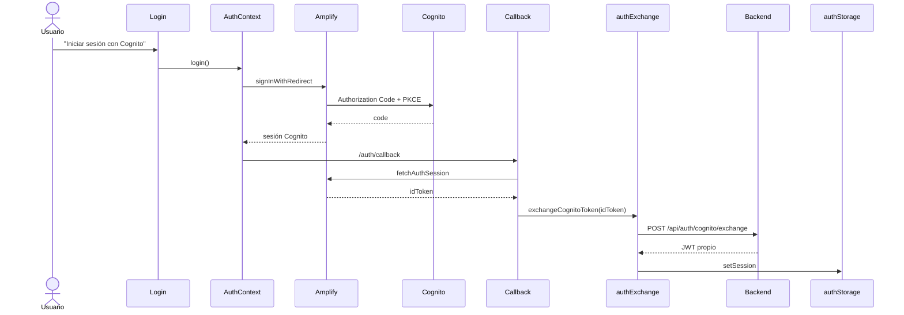
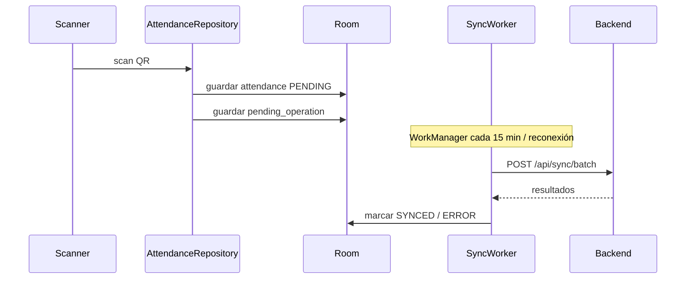
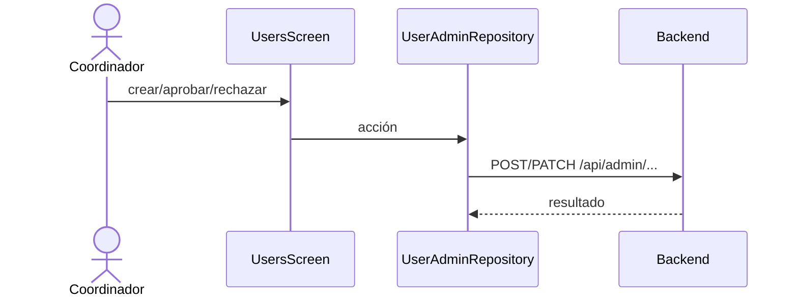
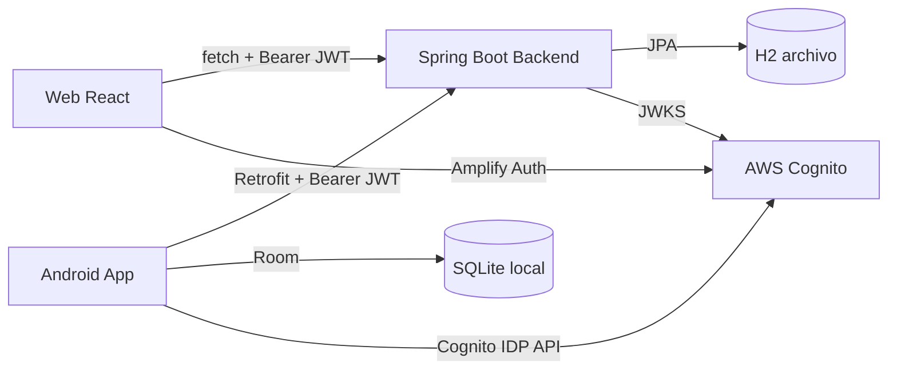

# ARQUITECTURA COMPLETA SYNCPASS

## 1. Introducción y objetivo

SyncPass es un sistema fullstack para la gestión de proyectos comunitarios, eventos, inscripciones, asistencia mediante códigos QR, encuestas de satisfacción y reportes de impacto.

Está compuesto por tres proyectos independientes pero interoperables:

1. **Aplicación Android** (`C:\Users\milla\Documents\SyncPass\app`): cliente móvil nativo desarrollado en Kotlin con Jetpack Compose.
2. **Backend** (`C:\Users\milla\Documents\SyncPass\backend`): API REST desarrollada en Java 21 con Spring Boot.
3. **Aplicación Web** (`C:\Users\milla\OneDrive\Documents\SyncPass-Fullstack\frontend`): cliente web desarrollado en React + TypeScript + Vite.

El presente documento describe la arquitectura real de los tres componentes, basada en la inspección del código fuente. Se indica explícitamente qué funcionalidades están implementadas y cuáles están preparadas pero no activas.

---

## 2. Arquitectura general de los tres componentes



- El backend es la fuente de verdad. Expone una API REST con autenticación JWT propia y soporte opcional para intercambio de tokens Cognito.
- La app Android consume la API, guarda datos en Room para funcionar offline y sincroniza operaciones pendientes con WorkManager.
- La app Web utiliza AWS Amplify v6 para autenticarse con Cognito, intercambia el idToken por un JWT propio del backend y consume la API REST en las páginas de negocio.

---

## 3. Tecnologías y versiones utilizadas

### Android

| Tecnología | Versión / Referencia |
|---|---|
| Android Gradle Plugin | 9.2.1 |
| Kotlin | 2.4.21 |
| KSP | 2.3.12 |
| Compile SDK | 37 |
| Min SDK | 28 |
| Target SDK | 36 |
| Jetpack Compose BOM | 2026.09.00 |
| Room | 2.8.5 |
| Retrofit | 3.0.0 |
| OkHttp Logging | 5.5.0 |
| CameraX | 1.6.2 |
| ML Kit Barcode | 17.3.0 |
| ZXing Core | 3.5.4 |
| AppAuth | 0.11.1 |
| WorkManager | 2.12.0 |
| DataStore Preferences | 1.3.0 |
| Coroutines | 1.11.0 |

### Backend

| Tecnología | Versión / Referencia |
|---|---|
| Spring Boot | 3.5.16 |
| Java | 21 |
| Spring Data JPA | gestionado por BOM |
| Spring Security | gestionado por BOM |
| Spring Validation | gestionado por BOM |
| Spring OAuth2 Resource Server | gestionado por BOM |
| JJWT | 0.12.6 |
| H2 Database | runtime |
| Lombok | 1.18.x |

### Web

| Tecnología | Versión / Referencia |
|---|---|
| React | 19.3.1 |
| React DOM | 19.3.1 |
| TypeScript | ~7.0.2 |
| Vite | 8.3.5 |
| React Router DOM | 7.18.5 |
| AWS Amplify | 6.15.0 |
| Oxlint | 1.89.0 |

---

## 4. Estructura de carpetas y paquetes de cada proyecto

### Android

```
C:\Users\milla\Documents\SyncPass\
├── app\
│   ├── src\main\java\com\rojas\syncpass\
│   │   ├── MainActivity.kt
│   │   ├── SyncPassApp.kt
│   │   ├── core\
│   │   │   ├── AppContainer.kt
│   │   │   ├── auth\
│   │   │   │   ├── CognitoAuthConfig.kt
│   │   │   │   ├── CognitoAuthMessages.kt
│   │   │   │   └── CognitoDirectAuthService.kt
│   │   │   ├── config\AppConfig.kt
│   │   │   ├── network\NetworkMonitor.kt
│   │   │   └── util\
│   │   │       ├── Qr.kt
│   │   │       ├── Dates.kt
│   │   │       └── Hash.kt
│   │   ├── data\
│   │   │   ├── local\
│   │   │   │   ├── AppDatabase.kt
│   │   │   │   ├── Daos.kt
│   │   │   │   ├── DemoLocalSeeder.kt
│   │   │   │   ├── Entities.kt
│   │   │   │   └── Mappers.kt
│   │   │   ├── remote\
│   │   │   │   ├── AdminDtos.kt
│   │   │   │   ├── ApiDtos.kt
│   │   │   │   ├── ApiErrors.kt
│   │   │   │   ├── AuthApiService.kt
│   │   │   │   ├── AuthDtos.kt
│   │   │   │   ├── CognitoExchangeRequest.kt
│   │   │   │   ├── NetworkModule.kt
│   │   │   │   ├── RetrofitClient.kt
│   │   │   │   └── SyncPassApiService.kt
│   │   │   ├── repository\
│   │   │   │   ├── AuthRepository.kt
│   │   │   │   ├── UserAdminRepository.kt
│   │   │   │   ├── ProjectRepository.kt
│   │   │   │   ├── EventRepository.kt
│   │   │   │   ├── AttendanceRepository.kt
│   │   │   │   ├── SurveyRepository.kt
│   │   │   │   ├── SyncRepository.kt
│   │   │   │   ├── SessionRepository.kt
│   │   │   │   ├── DashboardRepository.kt
│   │   │   │   └── ReportRepository.kt
│   │   │   ├── session\
│   │   │   │   ├── SessionManager.kt
│   │   │   │   └── SessionState.kt
│   │   │   └── sync\
│   │   │       ├── SyncWorker.kt
│   │   │       └── SyncScheduler.kt (embebido en SyncWorker.kt)
│   │   └── ui\
│   │       ├── AppRoot.kt
│   │       ├── components\
│   │       ├── login\
│   │       ├── dashboard\
│   │       ├── projects\
│   │       ├── events\
│   │       ├── scanner\
│   │       ├── walkin\
│   │       ├── survey\
│   │       ├── reports\
│   │       ├── users\
│   │       ├── profile\
│   │       └── theme\
│   └── src\main\res\...
├── backend\
│   └── (ver sección backend)
├── gradle\libs.versions.toml
└── settings.gradle.kts
```

### Backend

```
C:\Users\milla\Documents\SyncPass\backend\
├── src\main\java\com\rojas\syncpass\backend\
│   ├── SyncPassBackendApplication.java
│   ├── config\
│   │   ├── CustomUserDetailsService.java
│   │   ├── DemoDataSeeder.java
│   │   ├── JwtAuthenticationFilter.java
│   │   ├── JwtService.java
│   │   ├── PasswordEncoderConfig.java
│   │   └── SecurityConfig.java
│   ├── domain\
│   │   ├── User.java
│   │   ├── Project.java
│   │   ├── Event.java
│   │   ├── Enrollment.java
│   │   ├── Attendance.java
│   │   ├── SurveyResponse.java
│   │   ├── CognitoLinkRequest.java
│   │   ├── UserCognitoLink.java
│   │   └── enums (Role, ProjectStatus, EventStatus, EnrollmentStatus, AttendanceMethod, SyncOperationType)
│   ├── dto\ApiDtos.java
│   ├── repo\
│   │   ├── UserRepository.java
│   │   ├── ProjectRepository.java
│   │   ├── EventRepository.java
│   │   ├── EnrollmentRepository.java
│   │   ├── AttendanceRepository.java
│   │   ├── SurveyRepository.java
│   │   ├── CognitoLinkRequestRepository.java
│   │   └── UserCognitoLinkRepository.java
│   ├── service\
│   │   ├── AdminUserService.java
│   │   ├── CognitoLinkRequestService.java
│   │   ├── CognitoTokenValidator.java
│   │   ├── CurrentUserService.java
│   │   ├── DtoMapper.java
│   │   ├── EventService.java
│   │   ├── ProjectService.java
│   │   ├── ReportService.java
│   │   └── SyncService.java
│   └── web\
│       ├── AdminCognitoLinkRequestController.java
│       ├── AdminUserController.java
│       ├── AuthCognitoController.java
│       ├── AuthController.java
│       ├── CognitoLinkAccessController.java
│       ├── EventController.java
│       ├── GlobalExceptionHandler.java
│       ├── HealthController.java
│       ├── ProjectController.java
│       ├── ReportController.java
│       └── SyncController.java
├── src\main\resources\
│   ├── application.yml
│   └── application-test.yml
├── data\syncpass.mv.db
├── data\syncpass.pre-recovery-20261030.mv.db
└── build.gradle.kts
```

### Web

```
C:\Users\milla\OneDrive\Documents\SyncPass-Fullstack\frontend\
├── src\
│   ├── App.tsx
│   ├── main.tsx
│   ├── components\
│   │   ├── layout\AppLayout.tsx
│   │   └── ui\Button.tsx, Card.tsx, Input.tsx
│   ├── config\
│   │   ├── api.ts
│   │   └── cognito.ts
│   ├── context\AuthContext.tsx
│   ├── pages\
│   │   ├── auth\Login.tsx, Callback.tsx
│   │   ├── dashboard\Dashboard.tsx
│   │   ├── projects\Projects.tsx
│   │   ├── events\Events.tsx
│   │   ├── attendance\Attendance.tsx
│   │   ├── surveys\Surveys.tsx
│   │   └── reports\Reports.tsx
│   ├── routes\
│   │   ├── AppRouter.tsx
│   │   └── ProtectedRoute.tsx
│   ├── services\
│   │   ├── api.ts
│   │   ├── apiClient.ts
│   │   └── authExchange.ts
│   ├── styles\
│   │   ├── global.css
│   │   ├── reset.css
│   │   └── variables.css
│   └── utils\
│       ├── authExchangeLock.ts
│       └── authStorage.ts
├── public\
├── package.json
├── tsconfig.json
├── vite.config.ts
└── .env.example
```

---

## 5. Arquitectura interna de Android

### Capas

1. **UI (Jetpack Compose)**: pantallas y ViewModels en `com.rojas.syncpass.ui.*`.
2. **ViewModel**: gestiona el estado de la UI y delega acciones a los repositorios.
3. **Repositorio**: orquesta fuentes locales (Room) y remotas (API).
4. **Datos locales**: Room (`AppDatabase`, DAOs, entidades) con soporte offline.
5. **Datos remotos**: Retrofit + OkHttp con interceptores de autenticación.
6. **Core**: utilidades, autenticación Cognito directa, monitoreo de red y contenedor de dependencias manual (`AppContainer`).

### Contenedor de dependencias

`com.rojas.syncpass.core.AppContainer` crea manualmente los singletones de la app: base de datos Room, `NetworkMonitor`, `SessionManager`, `CognitoDirectAuthService`, `NetworkModule` y todos los repositorios. No se usa Hilt/Dagger.

### Navegación

`com.rojas.syncpass.ui.AppRoot.kt` define `SyncPassAppRoot`, que observa el estado de sesión (`SessionState`) y muestra:

- `SplashScreen` durante la carga.
- `LoginScreen` si no hay sesión.
- `MainShell` con navegación inferior (`BottomNavigation`) si hay sesión.

Rutas principales: `dashboard`, `projects`, `events`, `reports` (solo coordinador), `users` (solo coordinador), `profile`, `project/{projectId}`, `event/{eventId}`, `event/{eventId}/walk-in`, `event/{eventId}/survey`, `scanner`.

### Autenticación

- `LoginViewModel` recoge usuario/contraseña.
- `AuthRepository.loginWithCognito` verifica conexión y llama a `CognitoDirectAuthService.signIn`, que realiza `InitiateAuth` contra `cognito-idp.<region>.amazonaws.com` con flujo `USER_PASSWORD_AUTH`.
- Si Cognito responde con idToken, se intercambia en el backend mediante `POST /api/auth/cognito/exchange`.
- Si la identidad no está vinculada, se muestra pantalla para solicitar acceso (`POST /api/auth/cognito/link-request`).
- `SessionManager` persiste la sesión en DataStore Preferences y mantiene caché en memoria del token.

### Modo offline

- Si no hay red, el login usa `localLogin` verificando `localPasswordHash` almacenado en Room.
- Los datos descargados se guardan en Room.
- Las operaciones de asistencia, walk-in y encuestas se guardan localmente y en `pending_operations`.
- `SyncWorker` (WorkManager) sincroniza cada 15 minutos o al detectar conexión.

### Temas y colores

Paleta definida en `com.rojas.syncpass.ui.theme.Color.kt`:

- `#271539` DeepPurple
- `#501F5A` DeepPlum
- `#915BA4` Lilac
- `#C2649B` Mauve
- `#E783B5` Pink

---

## 6. Arquitectura interna del frontend web

### Capas

1. **Entrada**: `src/main.tsx` configura AWS Amplify con `COGNITO_CONFIG` y monta `App`.
2. **Rutas**: `src/routes/AppRouter.tsx` define las rutas públicas y protegidas con `ProtectedRoute`.
3. **Autenticación**: `src/context/AuthContext.tsx` utiliza `aws-amplify/auth` (`signInWithRedirect`, `fetchAuthSession`, `signOut`).
4. **Intercambio de token**: `src/services/authExchange.ts` envía el `idToken` de Cognito a `POST /api/auth/cognito/exchange` y guarda el JWT propio en memoria (`authStorage`).
5. **Cliente HTTP**: `src/services/apiClient.ts` implementa `fetch` con header `Authorization: Bearer <token>`.
6. **UI**: componentes reutilizables en `src/components/ui/` y páginas en `src/pages/`.

### Estado actual de implementación

| Área | Estado |
|---|---|
| Estructura de rutas y layout | Implementado |
| Login visual + Cognito redirect | Implementado |
| Intercambio Cognito -> JWT propio | Implementado (cliente; requiere backend activo) |
| Cliente HTTP base | Implementado (`apiClient.ts` con `fetch`) |
| Páginas de negocio | Implementadas y **consumen la API real** (`/api/projects`, `/api/events`, etc.) |
| Protección de rutas | Implementada con `AuthContext`; autorización real validada por el backend |

---

## 7. Arquitectura interna del backend

### Capas

1. **Web**: controladores REST en `com.rojas.syncpass.backend.web`.
2. **Seguridad**: `SecurityConfig`, `JwtAuthenticationFilter`, `JwtService`, `CustomUserDetailsService`, `PasswordEncoderConfig`.
3. **Servicios**: lógica de negocio en `com.rojas.syncpass.backend.service`.
4. **Persistencia**: Spring Data JPA + entidades en `com.rojas.syncpass.backend.domain`.
5. **Base de datos**: H2 archivo en `backend/data/syncpass`.

### Configuración de seguridad

- `SecurityConfig` habilita `@EnableMethodSecurity`, desactiva CSRF, sesiones stateless, CORS desde `app.cors.allowed-origins` y agrega `JwtAuthenticationFilter`.
- Endpoints públicos: `/api/health`, `/api/auth/login`, `/api/auth/cognito/exchange`, `/api/auth/cognito/link-request`, `/h2-console/**`.
- Cualquier otra ruta requiere autenticación.
- `@PreAuthorize("hasRole('DOCENTE_COORDINADOR')")` protege operaciones administrativas.

---

## 8. Controladores, servicios, repositorios, entidades y endpoints

### Entidades principales (backend)

| Entidad | Archivo | Tabla |
|---|---|---|
| User | `domain/User.java` | `app_users` |
| Project | `domain/Project.java` | `projects` |
| Event | `domain/Event.java` | `events` |
| Enrollment | `domain/Enrollment.java` | `enrollments` |
| Attendance | `domain/Attendance.java` | `attendance` |
| SurveyResponse | `domain/SurveyResponse.java` | `surveys` |
| CognitoLinkRequest | `domain/CognitoLinkRequest.java` | `cognito_link_requests` |
| UserCognitoLink | `domain/UserCognitoLink.java` | `user_cognito_links` |

### Repositorios

Todos en `com.rojas.syncpass.backend.repo`. Interfaces Spring Data JPA con métodos de consulta personalizados.

### Servicios principales

| Servicio | Responsabilidad |
|---|---|
| `AdminUserService` | CRUD de usuarios internos y activación/desactivación |
| `CognitoLinkRequestService` | Flujo de solicitudes de vínculo Cognito (crear, aprobar, rechazar) |
| `CognitoTokenValidator` | Validación de tokens Cognito mediante JWKS |
| `CurrentUserService` | Obtener usuario autenticado desde `SecurityContext` |
| `EventService` | CRUD de eventos, inscripciones, asistencia QR/walk-in, encuestas |
| `ProjectService` | CRUD de proyectos |
| `ReportService` | Reporte de impacto agregado |
| `SyncService` | Sincronización batch/pull para la app móvil |

### Endpoints REST

#### Auth (`/api/auth`)

| Método | Ruta | Descripción |
|---|---|---|
| POST | `/api/auth/login` | Login usuario/contraseña, retorna JWT propio |
| GET | `/api/auth/me` | Usuario autenticado actual |
| POST | `/api/auth/cognito/exchange` | Intercambia idToken Cognito por JWT propio |

#### Cognito link público (`/api/auth/cognito`)

| Método | Ruta | Descripción |
|---|---|---|
| POST | `/api/auth/cognito/link-request` | Solicitar vínculo de identidad Cognito |

#### Admin users (`/api/admin/users`) — solo coordinador

| Método | Ruta | Descripción |
|---|---|---|
| GET | `/api/admin/users` | Listar usuarios |
| POST | `/api/admin/users` | Crear usuario |
| PATCH | `/api/admin/users/{id}/active` | Activar/desactivar usuario |

#### Admin Cognito link (`/api/admin/cognito-link-requests`) — solo coordinador

| Método | Ruta | Descripción |
|---|---|---|
| GET | `/api/admin/cognito-link-requests` | Listar solicitudes pendientes |
| POST | `/api/admin/cognito-link-requests/{id}/approve` | Aprobar solicitud |
| POST | `/api/admin/cognito-link-requests/{id}/reject` | Rechazar solicitud |

#### Proyectos (`/api/projects`)

| Método | Ruta | Descripción | Permiso |
|---|---|---|---|
| GET | `/api/projects` | Listar | Autenticado |
| GET | `/api/projects/{id}` | Obtener | Autenticado |
| POST | `/api/projects` | Crear | Coordinador |
| PUT | `/api/projects/{id}` | Actualizar | Coordinador |
| DELETE | `/api/projects/{id}` | Eliminar | Coordinador |

#### Eventos (`/api/events`)

| Método | Ruta | Descripción | Permiso |
|---|---|---|---|
| GET | `/api/events` | Listar | Autenticado |
| GET | `/api/events/{id}` | Obtener | Autenticado |
| GET | `/api/events/{id}/detail` | Detalle con estado propio | Autenticado |
| POST | `/api/events` | Crear | Coordinador |
| PUT | `/api/events/{id}` | Actualizar | Coordinador |
| DELETE | `/api/events/{id}` | Eliminar | Coordinador |
| GET | `/api/events/{id}/participants` | Participantes | Coordinador |
| GET | `/api/events/{id}/attendance` | Asistencias | Coordinador |
| POST | `/api/events/{id}/attendance/scan` | Escanear QR | Autenticado |
| POST | `/api/events/{id}/attendance/walk-in` | Registro manual | Autenticado |
| POST | `/api/events/{id}/enroll` | Inscribirse | Autenticado |
| DELETE | `/api/events/{id}/enroll` | Cancelar inscripción | Autenticado |
| POST | `/api/events/{id}/survey` | Enviar encuesta | Autenticado |
| GET | `/api/events/{id}/survey/summary` | Resumen encuesta | Coordinador |
| GET | `/api/events/{id}/surveys` | Listado encuestas | Coordinador |

#### Sync (`/api/sync`)

| Método | Ruta | Descripción |
|---|---|---|
| POST | `/api/sync/batch` | Subir operaciones offline |
| GET | `/api/sync/pull` | Descargar snapshot completo |

#### Reportes (`/api/reports`)

| Método | Ruta | Descripción | Permiso |
|---|---|---|---|
| GET | `/api/reports/impact` | Reporte de impacto | Coordinador |

#### Health

| Método | Ruta | Descripción |
|---|---|---|
| GET | `/api/health` | Health check público |

---

## 9. Comunicación mediante API REST

- Android usa Retrofit con dos interfaces: `AuthApiService` (autenticación) y `SyncPassApiService` (resto de la API).
- Web usa `fetch` a través de `apiClient.ts`.
- Ambos clientes envían `Authorization: Bearer <token>` donde `<token>` es el JWT propio del backend.
- La URL base se resuelve:
  - Android: `-PapiBaseUrl` > `.env` > `API_BASE_URL` env > default `http://192.168.1.6:8080/`.
  - Web: `import.meta.env.VITE_API_BASE_URL` > `http://localhost:8080`.

---

## 10. Métodos HTTP y formatos de intercambio

- Todos los endpoints aceptan y retornan JSON (`Content-Type: application/json`).
- Fechas se intercambian como cadenas ISO-8601 (backend `jackson.write-dates-as-timestamps: false`).
- Android usa Gson para serialización/deserialización. Nota: los DTOs de administración (`AdminDtos.kt`) usan `String` para fechas para evitar problemas de parseo con `Instant`.
- Respuestas de error siguen el formato `ApiError` (timestamp, status, error, message).

---

## 11. Autenticación, autorización, roles y permisos

### Roles

- `DOCENTE_COORDINADOR`
- `ESTUDIANTE_VOLUNTARIO_MONITOR`

### Flujo de autenticación

1. El cliente envía credenciales (login propio) o idToken Cognito al backend.
2. El backend valida y emite un JWT propio firmado con HS256 (`JwtService`).
3. El cliente incluye el JWT en cada petición.
4. `JwtAuthenticationFilter` valida el JWT, carga el usuario y construye el `SecurityContext`.
5. Los controladores usan `@PreAuthorize` para verificar roles.

### Autorización en Android

- `Session.isCoordinator` decide qué pantallas mostrar.
- El backend siempre vuelve a validar el rol; la UI solo oculta opciones como conveniencia.

### Autorización en Web

- `ProtectedRoute` verifica `authStorage.isAuthenticated()` y el rol del usuario en memoria.
- Es una protección de UX; la autorización real está en el backend.

---

## 12. AWS Cognito y AWS Amplify

### Android

- Archivo de configuración: `com.rojas.syncpass.core.auth.CognitoAuthConfig`.
- Servicio de autenticación directa: `CognitoDirectAuthService`.
- Realiza llamadas HTTPS a `https://cognito-idp.us-east-1.amazonaws.com/` con `X-Amz-Target`.
- Soporta flujo `USER_PASSWORD_AUTH` y desafío `NEW_PASSWORD_REQUIRED`.
- También existe configuración AppAuth para Hosted UI (`RedirectUriReceiverActivity` en `AndroidManifest.xml`), pero el flujo activo es el directo.

### Web

- Usa `aws-amplify/auth` v6.
- Configuración en `src/config/cognito.ts` y `src/main.tsx`.
- Flujo: `signInWithRedirect` -> callback `/auth/callback` -> `fetchAuthSession` -> `exchangeCognitoToken` -> JWT propio.

### Backend

- `CognitoTokenValidator` obtiene JWKS desde `app.cognito.jwks-uri`.
- Valida firma RS256, issuer, expiración, `token_use`, `client_id`/`aud` y `sub`.
- `AuthCognitoController.exchange` convierte un token Cognito validado en JWT propio si existe `UserCognitoLink`.
- `CognitoLinkRequestService` gestiona aprobación/rechazo de solicitudes de vínculo.

---

## 13. Spring Security y JWT

### Componentes

- `SecurityConfig`: configura la cadena de filtros, CORS, endpoints públicos y `JwtAuthenticationFilter`.
- `JwtAuthenticationFilter`: extrae el header `Authorization: Bearer`, valida el token con `JwtService` y carga el usuario.
- `JwtService`: genera/valida JWT con HS256; claims `uid` y `role`.
- `CustomUserDetailsService`: carga usuario por username/email y asigna autoridad `ROLE_<rol>`.
- `PasswordEncoderConfig`: expone `BCryptPasswordEncoder`.

### Nota de recuperación administrativa

Durante la recuperación se creó un runner temporal (`RecoveryCoordinatorRunner`) y un perfil `recovery` con `web-application-type: none`. Ambos fueron eliminados tras completar la operación. Quedan permanentes:

- `PasswordEncoderConfig.java`
- `@ConditionalOnWebApplication` en `SecurityConfig.java` y `AuthController.java`

Esto permite que un futuro runner no web pueda cargar el contexto de Spring sin iniciar Tomcat.

---

## 14. Bases de datos y persistencia

### Backend

- **Tecnología**: H2 Database en modo archivo.
- **URL**: `jdbc:h2:file:./data/syncpass;MODE=PostgreSQL;DB_CLOSE_ON_EXIT=FALSE`
- **DDL**: `hibernate.ddl-auto: update`
- **Consola H2**: habilitada en `/h2-console`.
- **Archivos**: `backend/data/syncpass.mv.db`, `backend/data/syncpass.trace.db`.
- **Backup**: `backend/data/syncpass.pre-recovery-20261030.mv.db`.

### Android local

- **Tecnología**: Room sobre SQLite.
- **Nombre**: `syncpass.db`.
- **Entidades**: `UserEntity`, `ProjectEntity`, `EventEntity`, `EnrollmentEntity`, `AttendanceEntity`, `SurveyEntity`, `PendingOperationEntity`.
- **Versión**: 2 con migración aditiva `MIGRATION_1_2`.

### Tests del backend

- Usan H2 en memoria (`jdbc:h2:mem:syncpass-test`) con perfil `test` y `ddl-auto: create-drop`.

---

## 15. Room y H2, diferenciando responsabilidades

| Aspecto | Room (Android) | H2 (Backend) |
|---|---|---|
| Ubicación | Dispositivo móvil | Servidor (actualmente máquina local) |
| Rol | Caché local y outbox de operaciones offline | Fuente de verdad persistente |
| Escrituras | Asistencias, walk-ins, encuestas y operaciones pendientes offline | Toda la lógica de negocio y usuarios |
| Sincronización | `SyncWorker` envía operaciones pendientes al backend | Recibe operaciones vía `/api/sync/batch` |
| Autenticación | Hash local para login offline | Credenciales reales y tokens JWT |

---

## 16. Funcionamiento de los códigos QR

### Generación

- `com.rojas.syncpass.core.util.Qr` usa ZXing para generar bitmaps.
- Formato del payload: `SYNCPASS|EVENT|<eventId>|<qrToken>`.
- El backend genera `qrToken` único por evento (prefijo `SP-`).

### Escaneo

- Android usa CameraX + ML Kit Barcode Scanning.
- `ScannerViewModel` / `ScannerScreen` procesan el código.
- `Qr.parse` extrae `eventId` y `token` del formato `SYNCPASS|EVENT|...` o acepta el token crudo.
- Se envía `POST /api/events/{id}/attendance/scan` con `{ qrCode: ... }`.
- Si no hay red, la operación se guarda en `pending_operations` y `attendance` con `syncState = PENDING`.

---

## 17. Flujos principales

### Login Android (Cognito + JWT propio)



### Login Web (Cognito Amplify + intercambio)



### Flujo de asistencia offline Android



### Administración de usuarios y vínculos Cognito



---

## 18. Variables de entorno y configuración de cada componente

### Android

Archivo `app/build.gradle.kts` resuelve `API_BASE_URL` en este orden:

1. Propiedad del proyecto `-PapiBaseUrl`
2. Archivo `.env` (`API_BASE_URL`)
3. Variable de entorno `API_BASE_URL`
4. Default `http://192.168.1.6:8080/`

Variables adicionales:

- `SYNCPASS_BUILD_DIR`: directorio de build externo (útil si el proyecto está en OneDrive).
- `JAVA_HOME`: JDK 21 para Gradle.

### Backend

Archivo `backend/src/main/resources/application.yml`:

| Variable | Descripción |
|---|---|
| `SERVER_PORT` | Puerto del servidor (default 8080) |
| `JWT_SECRET` | Secreto para firmar JWT |
| `JWT_EXPIRATION_MS` | Expiración del token (default 7 días) |
| `CORS_ALLOWED_ORIGINS` | Orígenes permitidos (default `*`) |
| `SEED_DEMO_DATA` | Sembrar datos demo (default `true`) |
| `COGNITO_ISSUER` | Issuer del User Pool Cognito |
| `COGNITO_CLIENT_ID` | App Client ID de Cognito |
| `COGNITO_REGION` | Región AWS |
| `COGNITO_JWKS_URI` | Endpoint JWKS de Cognito |

> No se incluyen los valores por defecto por seguridad; están definidos en `application.yml`.

### Web

Variables Vite (públicas, prefijo `VITE_`):

| Variable | Descripción |
|---|---|
| `VITE_API_BASE_URL` | URL base del backend o API Gateway |
| `VITE_AWS_REGION` | Región AWS |
| `VITE_COGNITO_USER_POOL_ID` | ID del User Pool |
| `VITE_COGNITO_APP_CLIENT_ID` | App Client ID web |
| `VITE_COGNITO_DOMAIN` | Dominio Cognito Hosted UI |
| `VITE_REDIRECT_SIGN_IN` | Callback después del login |
| `VITE_REDIRECT_SIGN_OUT` | Callback después del logout |

El archivo `.env.example` contiene valores de ejemplo.

---

## 19. Puertos y direcciones de conexión

| Componente | Puerto default | URL |
|---|---|---|
| Backend Spring Boot | 8080 | `http://localhost:8080` |
| Consola H2 | 8080 | `http://localhost:8080/h2-console` |
| Web Vite dev server | 5173 | `http://localhost:5173` |
| Android app | N/A | Depende de la red (emulador `10.0.2.2:8080`, dispositivo físico IP LAN) |

---

## 20. Diagramas Mermaid de arquitectura y flujos

### Arquitectura de componentes



### Flujo de datos offline

```mermaid
flowchart TD
    A[Usuario escanea QR] --> B{¿Hay red?}
    B -->|Sí| C[Enviar a /api/events/{id}/attendance/scan]
    B -->|No| D[Guardar en Room attendance PENDING]
    D --> E[Guardar pending_operation]
    E --> F[WorkManager sincroniza al reconectar]
    F --> C
    C --> G[Backend persiste en H2]
```

---

## 21. Instrucciones para ejecutar cada proyecto

### Backend

```powershell
cd C:\Users\milla\Documents\SyncPass\backend
$env:JAVA_HOME="C:\Users\<usuario>\.gradle\jdks\eclipse_adoptium-21-amd64-windows.2"
.\gradlew.bat bootRun
```

Verificar salud:

```powershell
Invoke-RestMethod http://localhost:8080/api/health
```

Tests:

```powershell
.\gradlew.bat test
```

### Android

```powershell
cd C:\Users\milla\Documents\SyncPass
$env:JAVA_HOME="C:\Users\<usuario>\.gradle\jdks\eclipse_adoptium-21-amd64-windows.2"
$env:SYNCPASS_BUILD_DIR="C:\Users\<usuario>\AppData\Local\Temp\opencode\syncpass-build"
.\gradlew.bat :app:assembleDebug "-PapiBaseUrl=http://10.0.2.2:8080/"
adb install -r "$env:SYNCPASS_BUILD_DIR\app\outputs\apk\debug\app-debug.apk"
adb shell am start -n com.rojas.syncpass/.MainActivity
```

Tests unitarios:

```powershell
.\gradlew.bat :app:testDebugUnitTest
```

### Web

```powershell
cd C:\Users\milla\OneDrive\Documents\SyncPass-Fullstack\frontend
npm install
npm run dev
```

Build:

```powershell
npm run build
```

---

## 22. Requisitos y pasos previstos para desplegar el backend en AWS EC2

1. **Infraestructura base**
   - Crear instancia EC2 (Amazon Linux 2023 / Ubuntu 24.04 LTS).
   - Configurar Security Group: puertos 22 (SSH), 80 (HTTP) y 443 (HTTPS).
   - Asignar Elastic IP para dirección fija.

2. **Java**
   - Instalar JDK 21 (Amazon Corretto u OpenJDK).
   - Verificar: `java -version`.

3. **Base de datos**
   - Decidir si se mantiene H2 archivo o se migra a PostgreSQL/MySQL/RDS.
   - Si se mantiene H2: montar un volumen EBS persistente para `data/`.
   - Si se migra: actualizar `application.yml` con URL, usuario y contraseña de RDS.

4. **Aplicación**
   - Copiar el JAR generado por `bootJar`.
   - Ejecutar como servicio systemd:

```ini
# /etc/systemd/system/syncpass.service
[Unit]
Description=SyncPass Backend
After=network.target

[Service]
User=syncpass
Group=syncpass
ExecStart=/usr/bin/java -jar /opt/syncpass/syncpass-backend-1.0.0.jar
WorkingDirectory=/opt/syncpass
Environment="JWT_SECRET=<secreto-largo-y-aleatorio>"
Environment="CORS_ALLOWED_ORIGINS=https://<dominio-web>"
Environment="SERVER_PORT=8080"
Environment="SEED_DEMO_DATA=false"
Restart=always

[Install]
WantedBy=multi-user.target
```

5. **Proxy inverso**
   - Instalar Nginx.
   - Configurar proxy inverso a `http://localhost:8080`.
   - Obtener certificado TLS con Let's Encrypt.

6. **Cognito**
   - Actualizar `COGNITO_ISSUER`, `COGNITO_CLIENT_ID` y `COGNITO_JWKS_URI` si cambian.
   - Configurar callback URLs del App Client web hacia el dominio de producción.

7. **Monitoreo**
   - CloudWatch Logs o rotación de logs local.
   - Alertas de salud (`/api/health`).

---

## 23. Consideraciones de seguridad para el despliegue

- **Nunca exponer** `JWT_SECRET`, credenciales de base de datos ni claves AWS.
- Usar **HTTPS** en producción.
- Configurar CORS con orígenes específicos; no usar `*` en producción.
- Deshabilitar consola H2 en producción (`spring.h2.console.enabled=false`) o protegerla.
- Cambiar `JWT_SECRET` por un valor largo y aleatorio.
- Firmar el APK Android con una keystore de release.
- Las variables Vite son públicas: solo colocar en ellas IDs/URLs no sensibles.
- Validar autorización siempre en el backend; no confiar en la UI.
- Rotar periódicamente secretos y tokens.

---

## 24. Riesgos, dependencias y aspectos que requieren verificación

| Riesgo / Dependencia | Impacto | Estado |
|---|---|---|
| H2 archivo en producción | Alto | Funcional para desarrollo; requiere decisión de migración a RDS/PostgreSQL |
| Variables Cognito hardcoded en Android | Medio | Valores en `CognitoAuthConfig.kt`; deben externalizarse |
| JWT propio con secreto por defecto | Alto | Debe cambiarse en producción |
| Web: token en memoria | Medio | Se pierde al recargar la página; requiere re-login |
| CORS `*` por defecto | Medio | Cambiar por orígenes específicos en producción |
| Consola H2 habilitada | Medio | Proteger o deshabilitar en producción |
| Ausencia de pruebas instrumentadas Android | Medio | Falta validación física de QR |
| Dependencia de red para login Cognito Android | Medio | Fallback offline existe pero requiere login previo |

### Aspectos no verificados

- No se verificó la existencia real de recursos AWS (User Pool, App Client web, API Gateway) más allá de los valores presentes en el código.
- No se verificó el despliegue en Vercel.
- No se verificó la integración end-to-end de la app Web con el backend.
- El flujo AppAuth/Hosted UI en Android está configurado en el manifest pero no verificado como flujo activo.

---

**Ubicaciones de este documento:**

- `C:\Users\milla\Documents\SyncPass\ARQUITECTURA_COMPLETA_SYNCPASS.md`
- `C:\Users\milla\Documents\SyncPass\backend\ARQUITECTURA_COMPLETA_SYNCPASS.md`
- `C:\Users\milla\OneDrive\Documents\SyncPass-Fullstack\frontend\ARQUITECTURA_COMPLETA_SYNCPASS.md`
