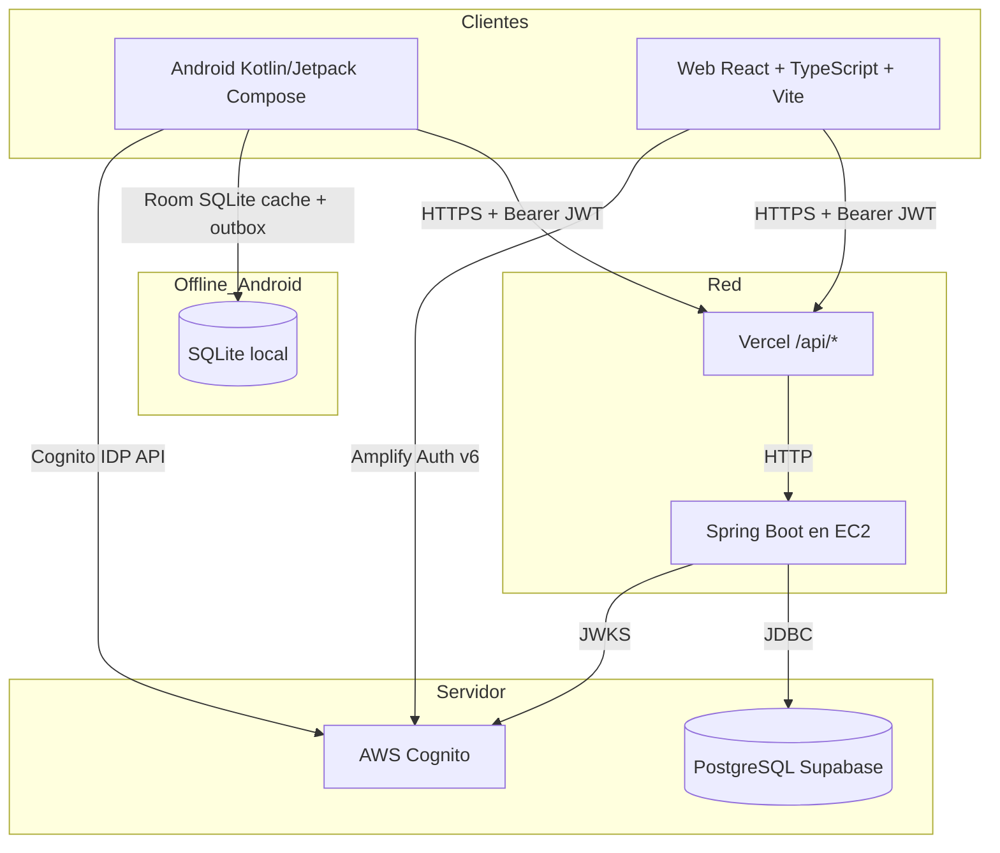
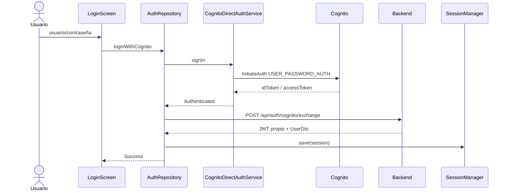
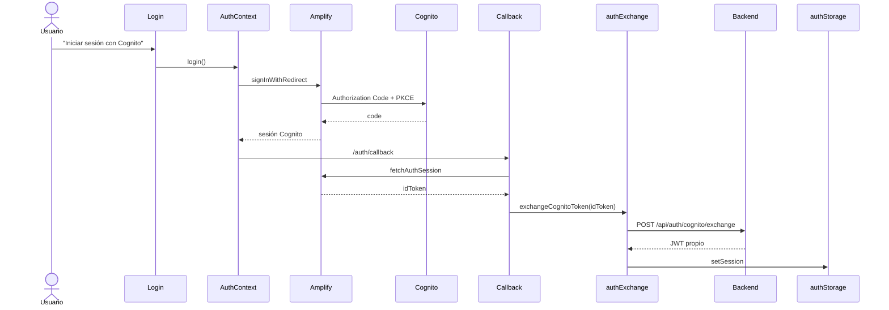
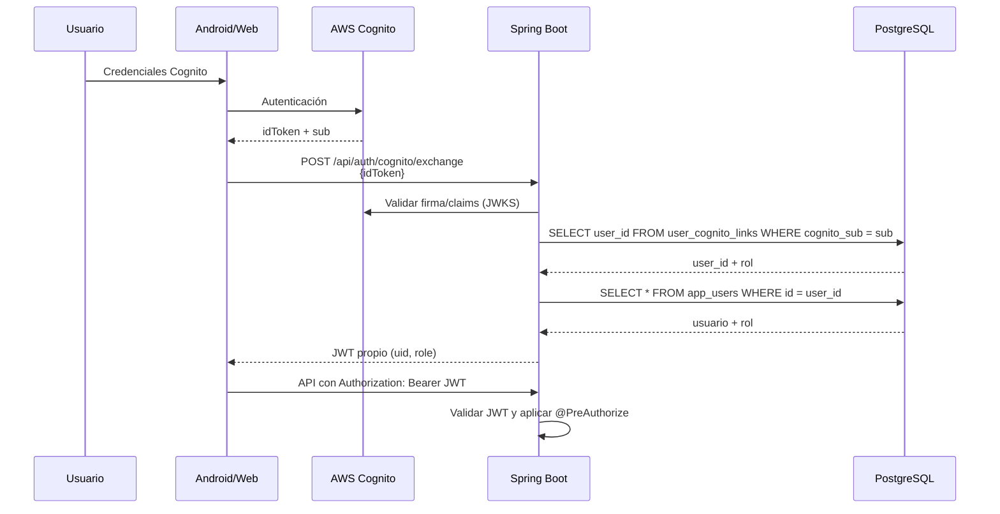
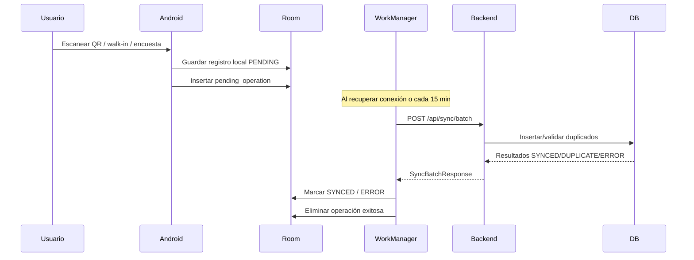
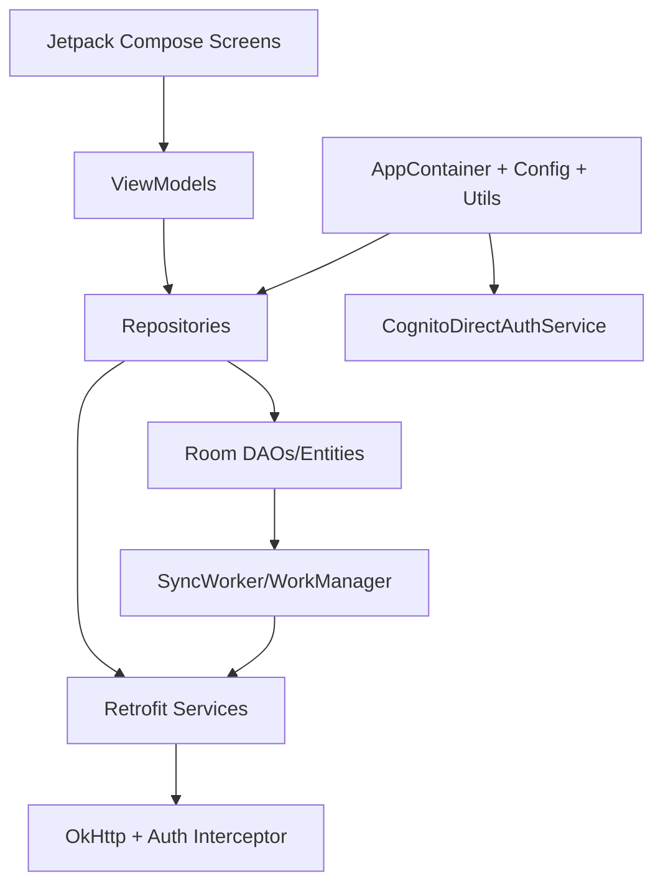
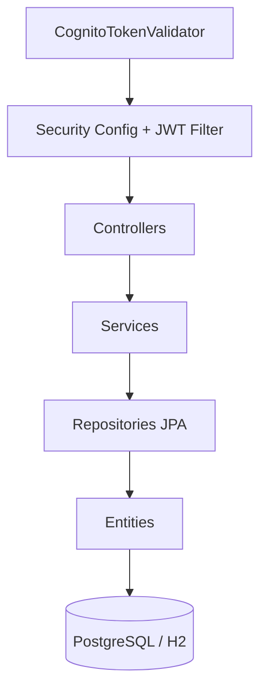

# Arquitectura Técnica de SyncPass

> **Versión actualizada al estado real del proyecto.**  
> Este documento describe cómo funciona SyncPass hoy, contrastado con el código fuente, la configuración de producción y las pruebas realizadas. No refleja aspiraciones ni diseños futuros no implementados.

---

## 1. Introducción y alcance

SyncPass es un sistema fullstack para la gestión de proyectos comunitarios, eventos, inscripciones, asistencia mediante códigos QR, registro de participantes no inscritos (walk-in), encuestas de satisfacción y reportes de impacto.

Está compuesto por tres componentes interoperables:

1. **Aplicación Android** (`app/`): cliente móvil nativo en Kotlin con Jetpack Compose.
2. **Backend** (`backend/`): API REST en Java 21 con Spring Boot.
3. **Aplicación Web** (`src/`): cliente web en React + TypeScript + Vite.

La fuente de verdad es PostgreSQL en Supabase (producción). El backend también puede ejecutarse con H2 en modo archivo para desarrollo local. La migración H2 → PostgreSQL está preparada pero pausada.

---

## 2. Arquitectura general



- El backend en EC2 es la fuente de verdad. Expone API REST con JWT propio e intercambia tokens Cognito.
- Vercel sirve el frontend y hace proxy de `/api/*` hacia EC2.
- Android consume la API, guarda datos en Room y sincroniza operaciones pendientes con WorkManager.
- La web usa AWS Amplify v6 para autenticarse con Cognito, intercambia el `idToken` por el JWT propio del backend y consume la API.

---

## 3. Tecnologías y versiones

### Android

| Tecnología | Referencia |
|---|---|
| Android Gradle Plugin | 9.2.1 |
| Kotlin | 2.4.21 |
| KSP | 2.3.12 |
| Compile SDK | 37 |
| Min/Target SDK | 28 / 36 |
| Jetpack Compose BOM | 2026.09.00 |
| Room | 2.8.5 |
| Retrofit | 3.0.0 |
| OkHttp Logging | 5.5.0 |
| CameraX | 1.6.2 |
| ML Kit Barcode | 17.3.0 |
| ZXing Core | 3.5.4 |
| AppAuth | 0.11.1 (configurado, no es el flujo activo) |
| WorkManager | 2.12.0 |
| DataStore Preferences | 1.3.0 |
| Coroutines | 1.11.0 |

### Backend

| Tecnología | Referencia |
|---|---|
| Spring Boot | 3.5.16 |
| Java | 21 |
| Spring Data JPA | gestionado por BOM |
| Spring Security | gestionado por BOM |
| Spring Validation | gestionado por BOM |
| JJWT | 0.12.6 |
| PostgreSQL driver | en classpath para `application-prod.yml` |
| H2 Database | modo archivo en desarrollo |
| Lombok | 1.18.x |

### Web

| Tecnología | Referencia |
|---|---|
| React | 19.3.1 |
| React DOM | 19.3.1 |
| TypeScript | ~7.0.2 |
| Vite | 8.3.5 |
| React Router DOM | 7.18.5 |
| AWS Amplify | 6.15.0 |
| Oxlint | 1.89.0 |

---

## 4. Estructura de carpetas

### Android

```
app/src/main/java/com/rojas/syncpass/
├── MainActivity.kt
├── SyncPassApp.kt
├── core/
│   ├── AppContainer.kt                 # contenedor de dependencias manual
│   ├── auth/
│   │   ├── CognitoAuthConfig.kt        # config de Cognito (dominio, clientId)
│   │   ├── CognitoAuthMessages.kt
│   │   └── CognitoDirectAuthService.kt # InitiateAuth / RespondToAuthChallenge
│   ├── config/AppConfig.kt             # baseUrl normalizada
│   ├── network/NetworkMonitor.kt
│   └── util/
│       ├── Qr.kt
│       ├── Dates.kt
│       └── Hash.kt
├── data/
│   ├── local/
│   │   ├── AppDatabase.kt
│   │   ├── Daos.kt
│   │   ├── DemoLocalSeeder.kt
│   │   ├── Entities.kt
│   │   └── Mappers.kt
│   ├── remote/
│   │   ├── AdminDtos.kt
│   │   ├── ApiDtos.kt
│   │   ├── ApiErrors.kt
│   │   ├── AuthApiService.kt
│   │   ├── AuthDtos.kt
│   │   ├── CognitoExchangeRequest.kt
│   │   ├── NetworkModule.kt
│   │   ├── RetrofitClient.kt           # objeto duplicado, no usado por AppContainer
│   │   └── SyncPassApiService.kt
│   ├── repository/
│   │   ├── AuthRepository.kt
│   │   ├── UserAdminRepository.kt
│   │   ├── ProjectRepository.kt
│   │   ├── EventRepository.kt
│   │   ├── AttendanceRepository.kt
│   │   ├── SurveyRepository.kt
│   │   ├── SyncRepository.kt
│   │   ├── SessionRepository.kt
│   │   ├── DashboardRepository.kt
│   │   └── ReportRepository.kt
│   ├── session/
│   │   ├── SessionManager.kt
│   │   └── SessionState.kt
│   └── sync/
│       └── SyncWorker.kt               # incluye SyncScheduler
└── ui/
    ├── AppRoot.kt
    ├── components/
    ├── login/
    ├── dashboard/
    ├── projects/
    ├── events/
    ├── scanner/
    ├── walkin/
    ├── survey/
    ├── reports/
    ├── users/
    ├── profile/
    └── theme/
```

### Backend

```
backend/src/main/java/com/rojas/syncpass/backend/
├── SyncPassBackendApplication.java
├── config/
│   ├── CustomUserDetailsService.java
│   ├── DemoDataSeeder.java
│   ├── JwtAuthenticationFilter.java
│   ├── JwtService.java
│   ├── PasswordEncoderConfig.java
│   └── SecurityConfig.java
├── domain/
│   ├── User.java
│   ├── Project.java
│   ├── Event.java
│   ├── Enrollment.java
│   ├── Attendance.java
│   ├── SurveyResponse.java
│   ├── CognitoLinkRequest.java
│   ├── UserCognitoLink.java
│   └── enums (Role, ProjectStatus, EventStatus, EnrollmentStatus, AttendanceMethod, SyncOperationType)
├── dto/ApiDtos.java
├── repo/
│   ├── UserRepository.java
│   ├── ProjectRepository.java
│   ├── EventRepository.java
│   ├── EnrollmentRepository.java
│   ├── AttendanceRepository.java
│   ├── SurveyRepository.java
│   ├── CognitoLinkRequestRepository.java
│   └── UserCognitoLinkRepository.java
├── service/
│   ├── AdminUserService.java
│   ├── CognitoLinkRequestService.java
│   ├── CognitoTokenValidator.java
│   ├── CurrentUserService.java
│   ├── DtoMapper.java
│   ├── EventService.java
│   ├── ProjectService.java
│   ├── ReportService.java
│   └── SyncService.java
└── web/
    ├── AdminCognitoLinkRequestController.java
    ├── AdminUserController.java
    ├── AuthCognitoController.java
    ├── AuthController.java
    ├── CognitoLinkAccessController.java
    ├── EventController.java
    ├── GlobalExceptionHandler.java
    ├── HealthController.java
    ├── ProjectController.java
    ├── ReportController.java
    └── SyncController.java
```

### Web

```
src/
├── App.tsx
├── main.tsx
├── config/
│   ├── api.ts                          # comentario desactualizado; la app sí consume API
│   └── cognito.ts
├── context/AuthContext.tsx
├── components/
│   ├── layout/AppLayout.tsx
│   └── ui/
├── pages/
│   ├── auth/Login.tsx, Callback.tsx
│   ├── dashboard/Dashboard.tsx
│   ├── projects/Projects.tsx
│   ├── events/Events.tsx
│   ├── attendance/Attendance.tsx
│   ├── surveys/Surveys.tsx
│   └── reports/Reports.tsx
├── routes/
│   ├── AppRouter.tsx
│   └── ProtectedRoute.tsx
├── services/
│   ├── api.ts
│   ├── apiClient.ts
│   └── authExchange.ts
├── styles/
└── utils/
    ├── authExchangeLock.ts
    └── authStorage.ts
```

---

## 5. Aplicación Android

### Patrón y capas

- **UI**: Jetpack Compose + ViewModels (`ui.*`).
- **ViewModel**: exponen `StateFlow` y delegan a repositorios.
- **Repositorio**: orquestan Room y la API REST.
- **Datos locales**: Room (`AppDatabase`, DAOs, entidades).
- **Datos remotos**: Retrofit + OkHttp con interceptor `Authorization: Bearer`.
- **Core**: `AppContainer` inyecta dependencias manualmente. No se usa Hilt.

### Navegación

`AppRoot.kt` observa `SessionState` y muestra `LoginScreen` o `MainShell` con `BottomNavigation`. Rutas principales:

- `dashboard`, `projects`, `events`, `attendance`, `reports` (solo coordinador), `users` (solo coordinador), `profile`
- `project/{projectId}`, `event/{eventId}`, `event/{eventId}/walk-in`, `event/{eventId}/survey`, `scanner`

### Autenticación



- `CognitoDirectAuthService` realiza llamadas directas a `https://cognito-idp.us-east-1.amazonaws.com/`.
- Soporta `USER_PASSWORD_AUTH` y el desafío `NEW_PASSWORD_REQUIRED`.
- El `idToken` se intercambia por el JWT propio en `/api/auth/cognito/exchange`.
- Si la identidad Cognito no está vinculada, la app muestra pantalla para solicitar acceso (`POST /api/auth/cognito/link-request`).
- `SessionManager` persiste la sesión en DataStore Preferences y mantiene caché en memoria del token.

### Persistencia local

- **Room** (`syncpass.db`, versión 2, migración aditiva 1→2).
- Entidades: `UserEntity`, `ProjectEntity`, `EventEntity`, `EnrollmentEntity`, `AttendanceEntity`, `SurveyEntity`, `PendingOperationEntity`.
- `DemoLocalSeeder` semilla usuarios demo para login offline si la tabla de usuarios está vacía.

### Funcionamiento offline

| Operación | ¿Offline? | Notas |
|---|---|---|
| Login con Cognito | No | Requiere red. Fallback offline solo con cuenta previamente usada. |
| Login offline | Sí | Verifica `localPasswordHash` en Room. |
| Ver proyectos | Sí | Desde Room. |
| Ver eventos | Sí | Desde Room. |
| Crear proyecto | **No** | Bloqueado explícitamente en `ProjectsViewModel.create`. |
| Editar/eliminar proyecto | No | Bloqueado explícitamente. |
| Crear evento | No | `EventRepository.create` llama a la API. |
| Escanear QR / walk-in | Sí | Se guardan en Room y outbox. |
| Inscribirse / cancelar inscripción | No | Requieren red. |
| Encuesta propia | Sí | Guardada localmente y en outbox. |
| Encuesta asistida | Sí | Guardada localmente y en outbox. |
| Sincronizar | No | Requiere red y sesión válida. |

### Outbox y sincronización

- Las operaciones offline se guardan en `PendingOperationEntity` con tipo:
  - `ATTENDANCE_QR`
  - `ATTENDANCE_WALK_IN`
  - `SURVEY`
- `SyncWorker` (WorkManager) se ejecuta al detectar conexión y periódicamente cada 15 minutos.
- Envía `POST /api/sync/batch` con las operaciones pendientes.
- El backend responde `SYNCED`, `DUPLICATE` o `ERROR` por cada operación.
- Android actualiza el estado local (`SYNCED`/`ERROR`) y elimina la operación exitosa.
- Para encuestas de monitores, el contenido se redacta localmente tras confirmar la sincronización.

### Control de duplicados

- Índice único `clientId` en `pending_operations`.
- Backend verifica `client_id` único en `attendances` y `survey_responses`.
- Si una operación ya existe, el backend devuelve `DUPLICATE` y Android la elimina de la outbox.

---

## 6. Aplicación Web

### Capas

1. **Entrada**: `src/main.tsx` configura AWS Amplify y monta `App`.
2. **Rutas**: `src/routes/AppRouter.tsx` define rutas públicas y protegidas.
3. **Autenticación**: `src/context/AuthContext.tsx` usa `aws-amplify/auth` (`signInWithRedirect`, `fetchAuthSession`, `signOut`).
4. **Intercambio**: `src/services/authExchange.ts` envía `idToken` a `POST /api/auth/cognito/exchange`.
5. **Cliente HTTP**: `src/services/apiClient.ts` con `fetch` y header `Authorization: Bearer`.
6. **UI**: componentes reutilizables y páginas en `src/pages/`.

### Flujo de autenticación



### Rutas y protección

| Ruta | Protección | Observación |
|---|---|---|
| `/login` | Pública | Redirige a Cognito Hosted UI. |
| `/auth/callback` | Pública | Intercambia sesión Cognito. |
| `/dashboard` | Autenticado | |
| `/projects` | Autenticado | Solo coordinador puede crear/editar/eliminar. |
| `/events` | Autenticado | Solo coordinador crea eventos. |
| `/attendance` | Autenticado | |
| `/surveys` | Autenticado | El formulario es público para usuarios autenticados; la tabla de respuestas individuales solo se muestra a coordinadores. |
| `/reports` | `DOCENTE_COORDINADOR` | |

### Consulta de respuestas individuales

La página `/surveys` ya incluye una tabla “Encuestas recibidas” que consulta `GET /api/events/{id}/surveys` y muestra:

- Participante
- Calificación general, organización e impacto
- Recomendación
- Comentario
- Fecha de envío

**Problema de UX conocido:** el selector de evento inicia en el primer evento de la lista (`/api/events` ordenados por `startsAt` ascendente). Si el coordinador no cambia el evento, puede ver respuestas de otro evento y pensar que faltan datos. El endpoint y el backend funcionan correctamente.

---

## 7. Backend

### Capas

1. **Web**: controladores REST en `com.rojas.syncpass.backend.web`.
2. **Seguridad**: `SecurityConfig`, `JwtAuthenticationFilter`, `JwtService`, `CustomUserDetailsService`.
3. **Servicios**: lógica de negocio en `com.rojas.syncpass.backend.service`.
4. **Persistencia**: Spring Data JPA + entidades en `com.rojas.syncpass.backend.domain`.
5. **Base de datos**: PostgreSQL en Supabase en producción; H2 archivo en desarrollo.

### Configuración de seguridad

- `@EnableMethodSecurity` habilita `@PreAuthorize`.
- Endpoints públicos: `/api/health`, `/api/auth/login`, `/api/auth/cognito/exchange`, `/api/auth/cognito/link-request`, `/h2-console/**`.
- Cualquier otra ruta requiere autenticación.
- Roles: `ROLE_DOCENTE_COORDINADOR` y `ROLE_ESTUDIANTE_VOLUNTARIO_MONITOR`.

### Endpoints principales

#### Auth (`/api/auth`)

| Método | Ruta | Descripción |
|---|---|---|
| POST | `/api/auth/login` | Login usuario/contraseña, retorna JWT propio |
| GET | `/api/auth/me` | Usuario autenticado actual |
| POST | `/api/auth/cognito/exchange` | Intercambia idToken Cognito por JWT propio |

#### Cognito link público (`/api/auth/cognito`)

| Método | Ruta | Descripción |
|---|---|---|
| POST | `/api/auth/cognito/link-request` | Solicitar vínculo de identidad Cognito |

#### Admin users (`/api/admin/users`) — coordinador

| Método | Ruta | Descripción |
|---|---|---|
| GET | `/api/admin/users` | Listar usuarios |
| POST | `/api/admin/users` | Crear usuario |
| PATCH | `/api/admin/users/{id}/active` | Activar/desactivar usuario |

#### Admin Cognito link (`/api/admin/cognito-link-requests`) — coordinador

| Método | Ruta | Descripción |
|---|---|---|
| GET | `/api/admin/cognito-link-requests` | Listar solicitudes pendientes |
| POST | `/api/admin/cognito-link-requests/{id}/approve` | Aprobar solicitud |
| POST | `/api/admin/cognito-link-requests/{id}/reject` | Rechazar solicitud |

#### Proyectos (`/api/projects`)

| Método | Ruta | Descripción | Permiso |
|---|---|---|---|
| GET | `/api/projects` | Listar | Autenticado |
| GET | `/api/projects/{id}` | Obtener | Autenticado |
| POST | `/api/projects` | Crear | Coordinador |
| PUT | `/api/projects/{id}` | Actualizar | Coordinador |
| DELETE | `/api/projects/{id}` | Eliminar | Coordinador |

#### Eventos (`/api/events`)

| Método | Ruta | Descripción | Permiso |
|---|---|---|---|
| GET | `/api/events` | Listar | Autenticado |
| GET | `/api/events/{id}` | Obtener | Autenticado |
| GET | `/api/events/{id}/detail` | Detalle con estado propio | Autenticado |
| POST | `/api/events` | Crear | Coordinador |
| PUT | `/api/events/{id}` | Actualizar | Coordinador |
| DELETE | `/api/events/{id}` | Eliminar | Coordinador |
| GET | `/api/events/{id}/participants` | Participantes | Coordinador |
| GET | `/api/events/{id}/attendance` | Asistencias | Coordinador |
| POST | `/api/events/{id}/attendance/scan` | Escanear QR | Autenticado |
| POST | `/api/events/{id}/attendance/walk-in` | Registro manual | Autenticado |
| POST | `/api/events/{id}/enroll` | Inscribirse | Autenticado |
| DELETE | `/api/events/{id}/enroll` | Cancelar inscripción | Autenticado |
| POST | `/api/events/{id}/survey` | Enviar encuesta | Autenticado |
| GET | `/api/events/{id}/survey/summary` | Resumen encuesta | Coordinador |
| GET | `/api/events/{id}/surveys` | Listado encuestas | Coordinador |

#### Sync (`/api/sync`)

| Método | Ruta | Descripción |
|---|---|---|
| POST | `/api/sync/batch` | Subir operaciones offline |
| GET | `/api/sync/pull` | Descargar snapshot completo |

#### Reportes (`/api/reports`)

| Método | Ruta | Descripción | Permiso |
|---|---|---|---|
| GET | `/api/reports/impact` | Reporte de impacto | Coordinador |

#### Health

| Método | Ruta | Descripción |
|---|---|---|
| GET | `/api/health` | Health check público |

---

## 8. Autenticación y autorización

### Roles de negocio

Los roles residen en PostgreSQL (`app_users.role`) y son la única fuente de autorización. **No se usan grupos de Cognito para autorizar**.

- `DOCENTE_COORDINADOR`
- `ESTUDIANTE_VOLUNTARIO_MONITOR`

### Flujo completo Cognito → JWT propio



### Vínculo Cognito ↔ usuario backend

- Tabla `user_cognito_links`: `cognito_sub` UNIQUE → `user_id` UNIQUE.
- Tabla `cognito_link_requests`: registra solicitudes de vínculo con estados `PENDING`, `APPROVED`, `REJECTED`.
- Coordinador crea usuario en `app_users`, luego aprueba la solicitud de vínculo, o bien se ejecuta una regularización autorizada directamente en BD.

### Estado actual de los vínculos (regularizado)

- Las tres cuentas de prueba/producción están vinculadas a usuarios y roles correctos.
- `user_cognito_links` mantiene vínculos demo originales reasignados a usuarios reales.
- No se usan credenciales legacy (`coordinador`/`[CREDENCIAL DE DEMOSTRACIÓN OMITIDA]`) en producción; se conservan solo para desarrollo local.

---

## 9. Usuarios y roles

### `DOCENTE_COORDINADOR`

- Crea y administra proyectos y eventos.
- Consulta participantes, inscripciones y asistencias.
- Registra walk-ins.
- Consulta encuestas, comentarios, resultados y reportes.
- Aprueba/rechaza solicitudes de vínculo Cognito.
- Crea y activa/desactiva usuarios backend.

### `ESTUDIANTE_VOLUNTARIO_MONITOR`

- Consulta proyectos y eventos.
- Se inscribe y cancela inscripción a eventos (requiere red).
- Escanea QR de evento para registrar su propia asistencia.
- Registra participantes no inscritos (walk-in), offline y online.
- Encuesta asistida únicamente sobre asistencias que él registró o escaneó.
- Trabaja offline y sincroniza después.
- **No** crea proyectos/eventos, **no** consulta reportes, **no** ve comentarios ni respuestas individuales.

### Beneficiario / asistente

- No inicia sesión.
- Puede ser registrado como walk-in por un monitor.
- Puede responder encuesta en el dispositivo del monitor.
- Su encuesta queda ligada a la asistencia y al evento.

---

## 10. Base de datos

### Producción

- **PostgreSQL 17** alojado en **Supabase**.
- Conectado desde EC2 mediante variables de entorno (`DATABASE_URL`, `DB_USER`, `DB_PASSWORD`).
- Hibernate `ddl-auto: validate` en producción; no genera schema automáticamente.

### Desarrollo

- **H2** en modo archivo (`backend/data/syncpass`).
- `ddl-auto: update`.
- Consola H2 habilitada en `/h2-console`.

### Migración H2 → PostgreSQL

- Está pausada y preservada.
- Los backups de H2 y los datos históricos se mantienen intactos.
- No se debe ejecutar migración destructiva sin autorización expresa.

### Tablas principales

| Tabla | Entidad | Propósito |
|---|---|---|
| `app_users` | `User` | Usuarios backend, roles, credenciales |
| `user_cognito_links` | `UserCognitoLink` | Vínculo sub Cognito ↔ usuario |
| `cognito_link_requests` | `CognitoLinkRequest` | Solicitudes de vínculo |
| `projects` | `Project` | Proyectos comunitarios |
| `events` | `Event` | Eventos de proyectos |
| `enrollments` | `Enrollment` | Inscripciones de usuarios a eventos |
| `attendances` | `Attendance` | Asistencias registradas |
| `survey_responses` | `SurveyResponse` | Respuestas de encuestas |

### Android local

- **Room** sobre SQLite.
- Tablas: `users`, `projects`, `events`, `enrollments`, `attendance`, `surveys`, `pending_operations`.
- Versión 2 con migración aditiva.

---

## 11. Sincronización offline/online



### Operaciones soportadas en outbox

- `ATTENDANCE_QR`
- `ATTENDANCE_WALK_IN`
- `SURVEY`

### Idempotencia

- `attendances.client_id` UNIQUE.
- `survey_responses.client_id` UNIQUE.
- `survey_responses.attendance_id` UNIQUE.
- `pending_operations.client_id` UNIQUE.
- Backend consulta existencia por `client_id` antes de insertar.

### Pull

- `GET /api/sync/pull` devuelve proyectos, eventos, inscripciones, asistencias y encuestas/receipts según rol.
- Android actualiza Room con los datos descargados.

### Errores

- Si una operación falla, Android la marca como `ERROR`, guarda el mensaje y WorkManager reintenta con backoff exponencial.
- Si la asistencia vinculada a una encuesta aún no existe en el servidor, `SyncService.processSurvey` devuelve `CONFLICT` y se reintenta en la siguiente sincronización.

---

## 12. Encuestas y reportes

### Encuestas propias

- Usuario autenticado responde por sí mismo.
- Se asocia a `user_id` y `event_id`.
- Regla: una encuesta por evento y usuario.

### Encuestas asistidas

- Monitor aplica encuesta a una asistencia que él registró o escaneó.
- Se asocia a `attendance_id` y `event_id`; `user_id` puede ser nulo para walk-ins.
- Regla: una encuesta por asistencia.
- El monitor no ve contenido después de sincronizar; solo recibo redactado.

### Reportes

- `GET /api/reports/impact` calcula métricas globales:
  - Total proyectos, eventos, inscripciones, asistencias.
  - Participantes únicos.
  - Tasa de asistencia.
  - Satisfacción promedio (`AVG(rating)`).
  - Tasa de recomendación.
- Los promedios se redondean a un decimal.

### Privacidad

- Solo coordinadores consultan respuestas individuales, comentarios y reportes.
- Backend refuerza la restricción con `@PreAuthorize("hasRole('DOCENTE_COORDINADOR')")`.

---

## 13. Infraestructura y despliegue

### Componentes

| Componente | Tecnología | Rol |
|---|---|---|
| Frontend web | Vercel | Sirve la SPA React y hace proxy de `/api/*` |
| Backend | AWS EC2 | Ejecuta Spring Boot |
| Base de datos | Supabase PostgreSQL | Persistencia de producción |
| Autenticación | AWS Cognito | User Pool y App Clients |
| DNS/ dominio | Vercel | `https://sync-pass.vercel.app` |

### Proxy Vercel → EC2

`vercel.json`:

```json
{
  "rewrites": [
    { "source": "/api/(.*)", "destination": "http://<EC2_IP>/api/$1" },
    { "source": "/(.*)", "destination": "/index.html" }
  ]
}
```

La producción web debe apuntar a `https://sync-pass.vercel.app`, que redirige las llamadas API al backend EC2.

### Perfiles de ejecución backend

- **Default (`application.yml`)**: H2 archivo, semilla demo activa.
- **`prod` (`application-prod.yml`)**: PostgreSQL Supabase, `ddl-auto: validate`, semilla desactivada.

### Variables de entorno por componente

#### Android (`.env` en raíz)

- `API_BASE_URL`
- `COGNITO_CLIENT_ID`
- `COGNITO_USER_POOL_DOMAIN`

#### Backend (`/etc/syncpass/syncpass.env` en EC2)

- `DATABASE_URL`
- `DB_USER`
- `DB_PASSWORD`
- `JWT_SECRET`
- `JWT_EXPIRATION_MS`
- `CORS_ALLOWED_ORIGINS`
- `COGNITO_ISSUER`
- `COGNITO_CLIENT_IDS`
- `COGNITO_REGION`
- `COGNITO_JWKS_URI`
- `SERVER_PORT`

#### Web (variables Vite)

- `VITE_API_BASE_URL`
- `VITE_AWS_REGION`
- `VITE_COGNITO_USER_POOL_ID`
- `VITE_COGNITO_APP_CLIENT_ID`
- `VITE_COGNITO_DOMAIN`
- `VITE_REDIRECT_SIGN_IN`
- `VITE_REDIRECT_SIGN_OUT`

> No se incluyen valores reales por seguridad.

---

## 14. Pruebas y validaciones realizadas

### Autenticación y roles

- [x] Login web con Cognito para los tres perfiles regularizados.
- [x] Login Android con Cognito para monitor.
- [x] Intercambio de idToken por JWT propio (`/api/auth/cognito/exchange`).
- [x] Acceso diferenciado de coordinador y monitor en Android y web.

### Datos y sincronización

- [x] Visualización de proyectos y eventos sin conexión (Android).
- [x] Registro de asistencia walk-in offline.
- [x] Sincronización posterior exitosa (`POST /api/sync/batch`).
- [x] Inscripción de monitor a evento (requiere red).
- [x] Encuesta offline y sincronización posterior.
- [x] Consulta individual de respuestas en la web (`/surveys`).
- [x] Actualización de indicadores de reportes tras sincronización.

### Compilación

- [x] `.​/gradlew.bat :app:assembleDebug` exitoso con configuración de producción.
- [x] Build web exitoso (`npm run build`).

### Pendiente / no verificado

- [ ] Pruebas instrumentadas de UI (Compose) automatizadas.
- [ ] Pruebas end-to-end del APK en dispositivo físico con QR impreso.
- [ ] Validación del flujo AppAuth/Hosted UI en Android (configurado pero no activo).
- [ ] Pruebas de carga o estrés.
- [ ] Migración H2 → PostgreSQL (pausada).

---

## 15. Limitaciones conocidas

1. **Creación offline de proyectos y eventos**: no está implementada. `ProjectsViewModel` y `EventRepository` bloquean escrituras sin red.
2. **Selección de evento en `/surveys`**: la página web inicia en el evento más antiguo por `startsAt`, no en el último evento con actividad.
3. **Comentario desactualizado en `src/config/api.ts`**: indica que no hay integración con backend, pero la aplicación web sí consume la API.
4. **RetrofitClient.kt duplicado**: existe un segundo cliente Retrofit no utilizado por `AppContainer`.
5. **JWT en memoria en web**: se pierde al recargar la página; requiere re-login.
6. **H2 en desarrollo / PostgreSQL en producción**: requiere cuidado con migraciones y compatibilidad de tipos.
7. **Dependencia de red para login Cognito Android**: el fallback offline requiere un login online previo.

---

## 16. Riesgos y aspectos de seguridad

| Riesgo | Impacto | Mitigación actual |
|---|---|---|
| Secreto JWT por defecto en desarrollo | Alto | Se externaliza en producción via `JWT_SECRET` |
| CORS `*` por defecto en desarrollo | Medio | Se restringe en producción via `CORS_ALLOWED_ORIGINS` |
| Consola H2 habilitada | Medio | Solo en perfil default; deshabilitar en producción |
| Token en memoria web | Medio | Re-login tras recarga; backend valida siempre |
| Sin pruebas instrumentadas Android | Medio | Validación manual realizada |
| Migración H2→PostgreSQL pausada | Alto | Backups preservados; sin ejecutar sin autorización |

---

## 17. Diagramas adicionales

### Arquitectura interna de Android



### Arquitectura interna del backend



### Modelo de roles y autorización

```mermaid
flowchart LR
    COG[AWS Cognito] -->|idToken| BE[Backend]
    BE -->|sub| LINK[user_cognito_links]
    LINK -->|user_id| USERS[app_users]
    USERS -->|role| AUTH[Spring Security]
    AUTH -->|@PreAuthorize| END[Endpoints]
```

---

## 18. Ubicaciones de documentación

- Documento principal: `C:\Users\milla\Documents\SyncPass\ARQUITECTURA_COMPLETA_SYNCPASS.md`
- Historial de cambios: `C:\Users\milla\Documents\SyncPass\HISTORIAL_COMPLETO_SYNCPASS.md`
- README del proyecto: `C:\Users\milla\Documents\SyncPass\README.md`
- Copia del backend (referencia): `C:\Users\milla\Documents\SyncPass\backend\ARQUITECTURA_COMPLETA_SYNCPASS.md`

---

**Última actualización:** 2026-11-02  
**Autoría:** Documentación técnica generada a partir de la inspección del código fuente y la configuración de producción de SyncPass.
