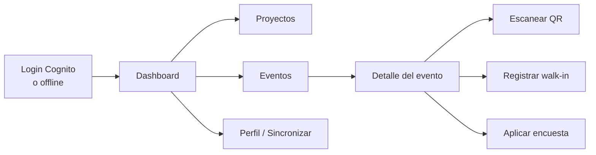

# Alcance de SyncPass

> Documento de alcance para la tercera entrega.  
> Basado en el código real de `app/` (Android), `src/` (React) y `backend/` (Spring Boot). Se diferencian explícitamente las funcionalidades implementadas de las pendientes.

---

## 1. Requisitos funcionales

### 1.1 Autenticación y autorización

| ID | Requisito | Estado |
|---|---|---|
| RF-01 | Inicio de sesión mediante AWS Cognito en Android y web. | Implementado |
| RF-02 | Intercambio del token Cognito por JWT propio de SyncPass. | Implementado |
| RF-03 | Roles de negocio (`DOCENTE_COORDINADOR`, `ESTUDIANTE_VOLUNTARIO_MONITOR`) gestionados en PostgreSQL. | Implementado |
| RF-04 | Protección de rutas y endpoints según rol. | Implementado |
| RF-05 | Solicitud y aprobación de vínculo Cognito ↔ usuario backend. | Implementado |
| RF-06 | Login offline en Android para cuentas previamente usadas en el dispositivo. | Implementado |

### 1.2 Gestión de proyectos y eventos

| ID | Requisito | Estado |
|---|---|---|
| RF-07 | Crear, editar y eliminar proyectos (coordinador). | **PARCIAL** — Crear y editar implementados en la web; eliminar solo disponible en el backend. |
| RF-08 | Crear, editar y eliminar eventos asociados a un proyecto (coordinador). | **PARCIAL** — Crear y editar implementados en la web; no existe eliminación desde la interfaz. |
| RF-09 | Listar y buscar proyectos y eventos. | Implementado |
| RF-10 | Ver detalle de proyecto y evento. | Implementado |
| RF-11 | Inscribirse y cancelar inscripción a un evento (monitor, requiere red). | Implementado |

### 1.3 Asistencia

| ID | Requisito | Estado |
|---|---|---|
| RF-12 | Generación de QR de evento para validar asistencia. | Implementado |
| RF-13 | Escaneo de QR con cámara y ML Kit (monitor). | Implementado |
| RF-14 | Registro de participantes no inscritos (*walk-in*) por coordinador o monitor. | Implementado |
| RF-15 | Listado de asistencias por evento (coordinador). | Implementado |

### 1.4 Encuestas

| ID | Requisito | Estado |
|---|---|---|
| RF-16 | Encuestas de satisfacción asistidas aplicadas por el monitor a un asistente. | Implementado |
| RF-17 | Encuestas propias del usuario autenticado. | Implementado (backend + web) |
| RF-18 | Consulta individual de respuestas y comentarios (coordinador). | Implementado |
| RF-19 | Resumen y promedios de encuestas por evento (coordinador). | Implementado |
| RF-20 | Redacción de encuestas en el dispositivo del monitor tras sincronizar. | Implementado |

### 1.5 Reportes y administración

| ID | Requisito | Estado |
|---|---|---|
| RF-21 | Reporte de impacto con métricas agregadas (coordinador). | Implementado |
| RF-22 | Crear, listar, activar y desactivar usuarios backend (coordinador). | Implementado |
| RF-23 | Listar y gestionar solicitudes de vínculo Cognito (coordinador). | Implementado |

### 1.6 Sincronización y offline

| ID | Requisito | Estado |
|---|---|---|
| RF-24 | Cache local de proyectos, eventos, inscripciones y asistencias en Android. | Implementado |
| RF-25 | Outbox de operaciones pendientes (asistencia QR, walk-in, encuestas). | Implementado |
| RF-26 | Sincronización automática al recuperar red, al iniciar sesión y periódicamente. | Implementado |
| RF-27 | Sincronización explícita mediante botón "Sincronizar ahora". | Implementado |
| RF-28 | Resolución de duplicados mediante `client_id` único. | Implementado |

---

## 2. Requisitos no funcionales

| ID | Requisito | Estado / Observación |
|---|---|---|
| RNF-01 | Seguridad: JWT propio firmado con HMAC-SHA256 y validación en backend. | Implementado |
| RNF-02 | Autorización: roles aplicados con `@PreAuthorize` en backend y `ProtectedRoute` en web. | Implementado |
| RNF-03 | Privacidad: los monitores no ven respuestas ni comentarios de encuestas; solo coordinadores. | Implementado |
| RNF-04 | Offline first en Android: lectura y escrituras locales con sincronización posterior. | Implementado (con limitaciones de escritura) |
| RNF-05 | Idempotencia en sincronización: reintentos seguros sin duplicar registros. | Implementado |
| RNF-06 | API REST stateless con JSON. | Implementado |
| RNF-07 | Base de datos relacional PostgreSQL en producción, H2 en desarrollo. | Implementado |
| RNF-08 | Cliente web responsivo con React + Vite. | Implementado |
| RNF-09 | Logs de auditoría en backend sin exponer tokens ni `sub` completos. | Implementado |
| RNF-10 | Cobertura de pruebas automatizada (JaCoCo / Vitest). | **Pendiente** |

---

## 3. Casos de uso detallados

### Actores

- **Coordinador docente:** crea proyectos/eventos, administra usuarios, consulta reportes, encuestas y asistencias.
- **Monitor estudiante:** consulta eventos, se inscribe, escanea QR, registra walk-ins, aplica encuestas asistidas.
- **Asistente / beneficiario:** no inicia sesión; es registrado por un monitor y puede responder una encuesta.
- **Sistema SyncPass:** backend que procesa reglas, sincronización y reportes.

### Casos de uso principales

#### UC-01: Iniciar sesión
1. El usuario introduce credenciales en Android o pulsa "Iniciar sesión con Cognito" en web.
2. AWS Cognito valida la identidad y devuelve un `idToken`.
3. La app/web envía el token a `POST /api/auth/cognito/exchange`.
4. El backend valida el token, busca el vínculo en `user_cognito_links`, obtiene el rol y emite el JWT propio.
5. El usuario accede a las funcionalidades permitidas por su rol.

#### UC-02: Crear un evento (coordinador)
1. El coordinador selecciona un proyecto.
2. Completa nombre, ubicación, fechas, capacidad y descripción.
3. El backend crea el evento y genera su `qrToken`.
4. El evento queda disponible para inscripción y escaneo.

#### UC-03: Registrar asistencia por QR (monitor)
1. El monitor abre el escáner en la app Android.
2. CameraX muestra el preview; ML Kit lee el QR del evento.
3. La app valida que el QR corresponda al evento activo.
4. Se guarda la asistencia localmente y se encola para sincronización.
5. Al recuperar red, WorkManager envía la operación al backend.

#### UC-04: Registrar walk-in
1. El monitor selecciona un evento y abre la pantalla de walk-in.
2. Ingresa nombre y, opcionalmente, email/documento del asistente.
3. La app guarda la asistencia localmente con `client_id` único.
4. Se sincroniza como una operación `ATTENDANCE_WALK_IN`.

#### UC-05: Aplicar encuesta asistida (monitor)
1. El monitor selecciona una asistencia que él registró o escaneó.
2. Completa calificaciones, comentario y recomendación.
3. La app guarda la encuesta localmente y la encola.
4. Tras sincronizar, el backend valida que la asistencia exista y almacena la respuesta.
5. En el dispositivo del monitor, el contenido de la encuesta se redacta.

#### UC-06: Ver reporte de impacto (coordinador)
1. El coordinador accede a `/reports` en la web.
2. El backend calcula métricas agregadas: proyectos, eventos, inscripciones, asistencias, satisfacción promedio.
3. La web muestra los indicadores.

---

## 4. Flujos principales

### 4.1 Flujo principal de Android



1. El monitor/coordinador inicia sesión.
2. Descarga datos mediante `GET /api/sync/pull` (o usa cache local).
3. Navega a eventos y realiza escaneos, walk-ins o encuestas.
4. Las operaciones offline se encolan y sincronizan automáticamente o con el botón "Sincronizar ahora".

### 4.2 Flujo principal de React

```mermaid
flowchart LR
    Login[Login Cognito] --> Callback[/auth/callback]
    Callback --> Dashboard[Dashboard]
    Dashboard --> Projects[Proyectos]
    Dashboard --> Events[Eventos]
    Dashboard --> Attendance[Asistencias]
    Dashboard --> Surveys[Encuestas]
    Dashboard --> Reports[Reportes]
```

1. El usuario inicia sesión con Cognito Hosted UI.
2. Amplify obtiene el `idToken` y la página `/auth/callback` lo intercambia por el JWT propio.
3. El usuario navega según su rol; `/reports` requiere coordinador.
4. Las páginas consumen `apiClient.ts` para llamar al backend.

---

## 5. Funcionalidades implementadas

### Android

- Login con Cognito y login offline.
- Navegación con Jetpack Compose y bottom bar.
- Listado y búsqueda de proyectos y eventos.
- Inscripción y cancelación de inscripción a eventos.
- Escaneo de QR con CameraX + ML Kit Barcode.
- Registro walk-in con validación local.
- Encuestas asistidas con redacción tras sincronización.
- Outbox y sincronización con WorkManager.
- Botón explícito "Sincronizar ahora".
- Dashboard con resumen local.

### Web

- Login con Cognito vía Amplify v6 (Authorization Code + PKCE).
- Callback que intercambia token y obtiene JWT propio.
- Rutas protegidas por autenticación y rol.
- Creación y edición de proyectos y eventos (coordinador); eliminación solo disponible en el backend.
- Listado de asistencias.
- Consulta de encuestas individuales y resumen.
- Reporte de impacto (coordinador).

### Backend

- API REST con Spring Boot.
- Autenticación JWT propio.
- Validación de tokens Cognito.
- CRUD de proyectos, eventos, usuarios.
- Endpoints de inscripción, asistencia QR, walk-in y encuestas.
- Sincronización batch (`/api/sync/batch`) y pull (`/api/sync/pull`).
- Reporte de impacto.
- Roles y autorización con `@PreAuthorize`.

---

## 6. Funcionalidades pendientes o limitadas

### Funcionalidad de negocio

- **Creación offline de proyectos y eventos:** no está implementada; requiere conexión.
- **Edición/eliminación offline:** no soportada.
- **Resolución avanzada de conflictos de sincronización:** solo maneja duplicados; no hay merge de campos.
- **Notificaciones push:** no implementadas.
- **Escaneo QR validado con dispositivo físico y QR impreso:** pendiente de validación real.

### Web

- **Persistencia de sesión:** el JWT propio se almacena solo en memoria; se pierde al recargar la página.
- **Variables de entorno Vite:** el `.env` local carece del prefijo `VITE_`; los builds locales no reciben URL ni Cognito a menos que Vercel las inyecte.

### Android

- **Flujo AppAuth / Hosted UI:** configurado en `AndroidManifest.xml` y dependencias, pero no es el flujo activo (se usa `CognitoDirectAuthService`).
- **Pruebas instrumentadas de UI:** no existen.

### Infraestructura y calidad

- **JaCoCo / cobertura de tests:** no configurado en Android.
- **Vitest / React Testing Library:** no configurado en web.
- **CI/CD reproducible:** no existe pipeline ni scripts de despliegue automatizado.
- **HTTPS entre Vercel y EC2:** el proxy actual usa HTTP.
- **Migración H2 → PostgreSQL:** pausada; los datos H2 se mantienen intactos.

### Documentación de entrega

- **Mockups y trazabilidad visual:** no creados todavía.

---

*Última actualización: 2026-11-19*
