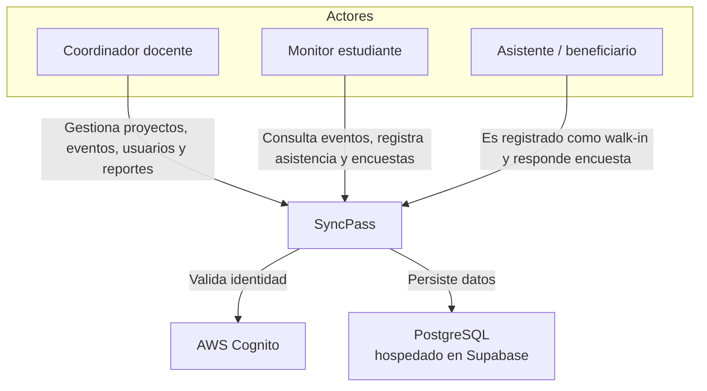
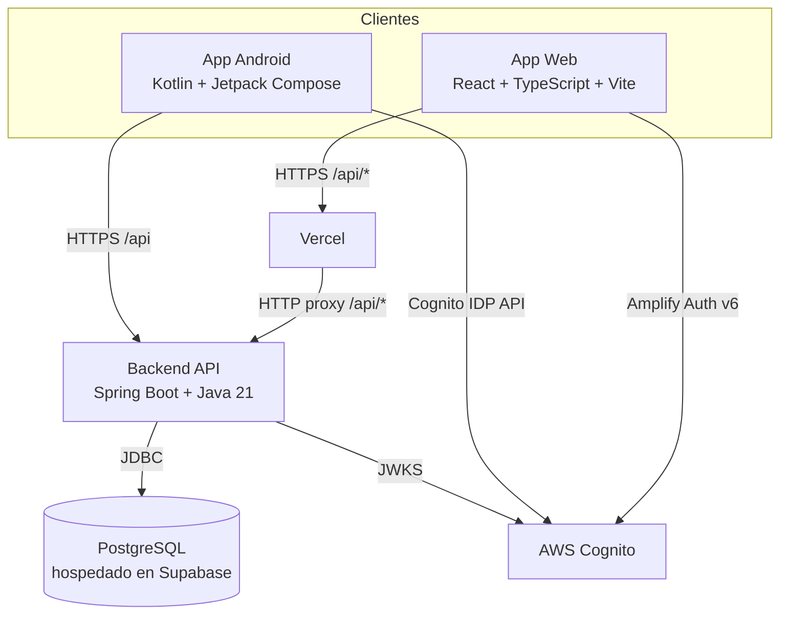
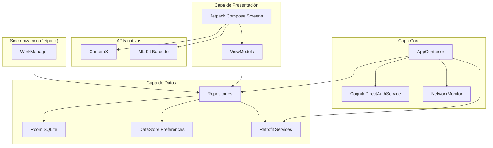
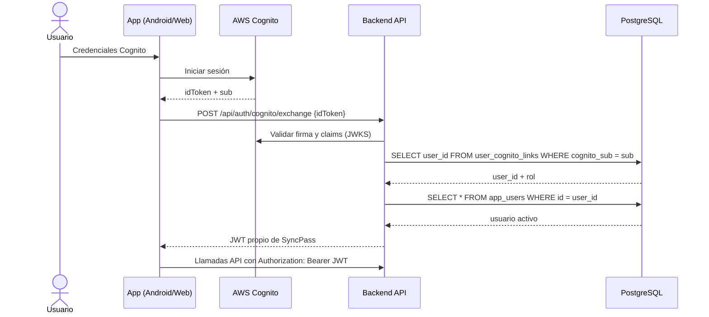
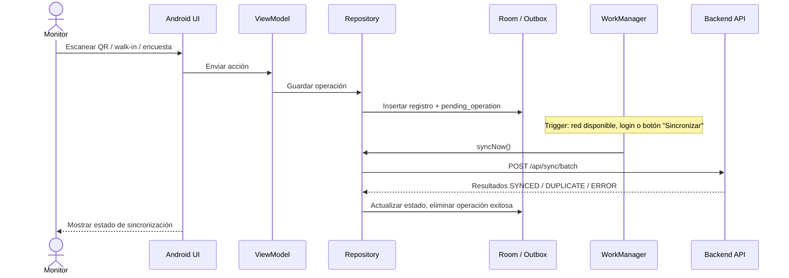

# Arquitectura de SyncPass

> Documento de arquitectura para la tercera entrega.  
> Se basa en la inspección del código real de Android (`app/`), React (`src/`) y backend (`backend/`). No incluye secretos, contraseñas ni tokens.

---

## 1. C4 Nivel 1 — Diagrama de contexto

### Descripción

SyncPass permite a coordinadores y monitores gestionar proyectos comunitarios, eventos, asistencias y encuestas. Los asistentes no necesitan cuenta; un monitor los registra como *walk-in* y, opcionalmente, les aplica una encuesta. La autenticación se delega a AWS Cognito. La persistencia usa PostgreSQL; en producción la base de datos está hospedada en Supabase y Spring Boot se conecta mediante JDBC. **No existe integración directa mediante SDK de Supabase.**

---

## 2. C4 Nivel 2 — Diagrama de contenedores

> **Nota sobre infraestructura:** En este diagrama Vercel y EC2 se representan como contenedores de despliegue y operación para claridad del flujo de datos. En una notación C4 estricta, Vercel es un sistema externo de hosting/proxy y EC2 es el nodo de infraestructura donde se ejecuta el backend; ninguno es un contenedor interno de negocio de SyncPass.

### Contenedores y responsabilidades

| Contenedor | Tecnología | Responsabilidad |
|---|---|---|
| **App Android** | Kotlin, Jetpack Compose, Room, WorkManager | Operación de campo: escaneo QR, registro walk-in, encuestas offline, sincronización. |
| **App Web** | React 19, TypeScript, Vite | Gestión administrativa: proyectos, eventos, asistencias, encuestas, reportes. |
| **Backend API** | Spring Boot 3, Java 21 | API REST, autenticación propia (JWT), validación Cognito, lógica de negocio, sincronización. |
| **Base de datos** | PostgreSQL (hospedado en Supabase en producción), H2 en desarrollo | Fuente de verdad. Spring Boot se conecta mediante JDBC; no se usa SDK de Supabase. |
| **Auth externo** | AWS Cognito | Emite tokens de identidad; el backend los valida y emite su propio JWT. |
| **Hosting web / proxy** | Vercel | Sirve la SPA y reescribe `/api/*` hacia el backend en EC2. |

---

## 3. C4 Nivel 3 — Componentes de Android (MVVM)

### Responsabilidades por capa

| Capa | Archivos clave | Responsabilidad |
|---|---|---|
| **Presentación** | `ui/*/*Screen.kt`, `ui/*/*ViewModel.kt` | Screens de Compose observan `StateFlow` expuestos por ViewModels; los ViewModels transforman eventos de UI en llamadas a repositorios. |
| **Core** | `core/AppContainer.kt`, `core/auth/CognitoDirectAuthService.kt`, `core/network/NetworkMonitor.kt` | Contenedor manual de dependencias, servicio de autenticación directa con Cognito y monitor de conectividad. |
| **Datos locales** | `data/local/AppDatabase.kt`, `data/local/Entities.kt`, `data/local/Daos.kt`, `data/session/SessionManager.kt` | Room como caché y outbox; DataStore para sesión, preferencias y timestamp de última sincronización. |
| **Datos remotos** | `data/remote/NetworkModule.kt`, `data/remote/SyncPassApiService.kt`, `data/remote/AuthApiService.kt` | Retrofit + OkHttp, interceptores de autenticación y DTOs de la API. |
| **Repositorios** | `data/repository/*Repository.kt` | Orquestan fuentes locales y remotas, aplican reglas de negocio (p. ej., `AttendanceSurveyPolicy`) y gestionan la outbox. |
| **Sincronización** | `data/sync/SyncWorker.kt`, `data/sync/SyncScheduler.kt` | WorkManager ejecuta `syncNow()` periódicamente, al recuperar red, al iniciar sesión y bajo demanda mediante botón. |
| **APIs nativas** | `ui/scanner/ScannerScreen.kt`, `build.gradle.kts` | CameraX para preview y ML Kit Barcode Scanning para lectura de códigos QR. |

---

## 4. Flujo de autenticación

### Notas

- Los roles de negocio residen en `app_users.role`; **no se usan grupos de Cognito para autorizar**.
- Si el `sub` no está vinculado, el backend responde `403` y la app puede solicitar un vínculo mediante `/api/auth/cognito/link-request`.
- En Android la autenticación usa `CognitoDirectAuthService` (llamadas a Cognito IDP). En web se usa AWS Amplify v6 con Authorization Code + PKCE.

---

## 5. Flujo de datos y sincronización offline

### Operaciones offline soportadas

| Operación | Guarda en outbox | Sincroniza vía `/api/sync/batch` |
|---|---|---|
| Asistencia QR | Sí | Sí |
| Walk-in | Sí | Sí |
| Encuesta asistida | Sí | Sí |
| Crear proyecto | **No** | — |
| Crear evento | **No** | — |
| Inscripción / cancelación | **No** | — |

### Idempotencia

- `attendances.client_id` y `survey_responses.client_id` son únicos.
- El backend devuelve `DUPLICATE` si la operación ya existe; Android la elimina de la outbox.
- Las encuestas de monitores se redactan localmente tras confirmar la sincronización.

---

## 6. Tecnologías y responsabilidades de cada capa

### Android

| Tecnología | Versión / Librería | Responsabilidad |
|---|---|---|
| Lenguaje | Kotlin 2.4.21 | Lógica de presentación, dominio y datos. |
| UI | Jetpack Compose (BOM 2026.09.00) | Declaración de interfaces reactivas. |
| Arquitectura | MVVM manual + repositorios | ViewModels exponen estado; repositorios abstraen fuentes de datos. |
| Persistencia local | Room 2.8.5 + SQLite | Cache de catálogos y outbox de operaciones offline. |
| Preferencias | DataStore Preferences 1.3.0 | Sesión, token en memoria y timestamp de sincronización. |
| Red | Retrofit 3.0.0 + OkHttp | Llamadas REST tipadas. |
| Auth | CognitoDirectAuthService | Autenticación directa contra Cognito IDP. |
| Cámara / QR | CameraX 1.6.2 + ML Kit Barcode 17.3.0 | Escaneo de códigos QR de evento. |
| Sincronización | WorkManager 2.12.0 | Tareas periódicas y bajo demanda. |
| Inyección | AppContainer manual | Fábrica de dependencias sin Hilt. |

### Backend

| Tecnología | Versión / Librería | Responsabilidad |
|---|---|---|
| Framework | Spring Boot 3.5.16 | API REST, seguridad, persistencia. |
| Lenguaje | Java 21 | Lógica de negocio y seguridad. |
| Seguridad | Spring Security + JWT HS256 | Autenticación y autorización por roles. |
| Persistencia | Spring Data JPA + Hibernate | Mapeo objeto-relacional. |
| BD producción | PostgreSQL (hospedado en Supabase, conexión JDBC) | Fuente de verdad. Sin SDK de Supabase. |
| BD desarrollo | H2 archivo | Desarrollo local y tests. |
| Auth externo | CognitoTokenValidator (Nimbus JOSE) | Validación de tokens Cognito. |

### Web

| Tecnología | Versión / Librería | Responsabilidad |
|---|---|---|
| Lenguaje | TypeScript 7.0.2 | Tipado estático. |
| Framework UI | React 19.3.1 | Componentes y estado. |
| Router | React Router DOM 7.18.5 | Navegación y rutas protegidas. |
| Auth | AWS Amplify v6 | Login con Cognito Hosted UI / Authorization Code + PKCE. |
| Build | Vite 8.3.5 | Bundling y desarrollo. |
| HTTP | fetch + apiClient.ts | Cliente HTTP genérico con tipos. |
| Estado auth | AuthContext + authStorage | Contexto global y almacenamiento en memoria del JWT. |

---

## 7. Decisiones arquitectónicas relevantes

1. **MVVM manual en Android.** Se optó por ViewModels + repositorios + contenedor manual de dependencias; no se usa Hilt.
2. **Sincronización basada en outbox.** Las operaciones offline se guardan en Room y se envían en lotes mediante `/api/sync/batch`.
3. **JWT propio de SyncPass.** Cognito solo valida identidad; el backend emite un JWT propio con rol y userId.
4. **Web proxy a backend.** Vercel reescribe `/api/*` hacia EC2; la web no llama directamente a EC2.
5. **BD dual H2 / PostgreSQL.** El backend puede ejecutarse con H2 en desarrollo y PostgreSQL en producción mediante perfiles de Spring.

---

*Última actualización: 2026-11-19*
